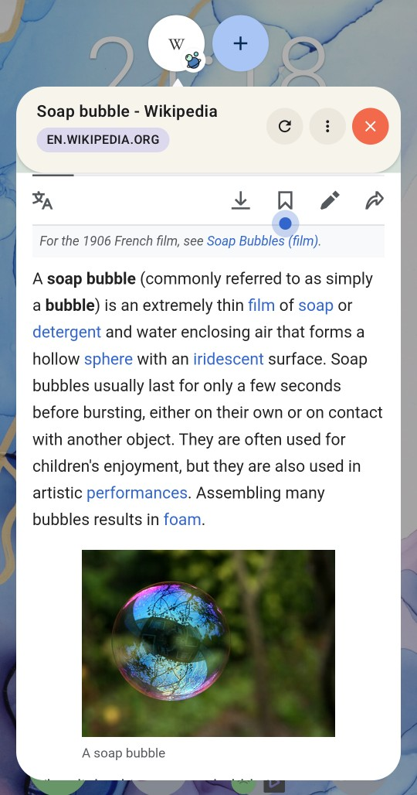
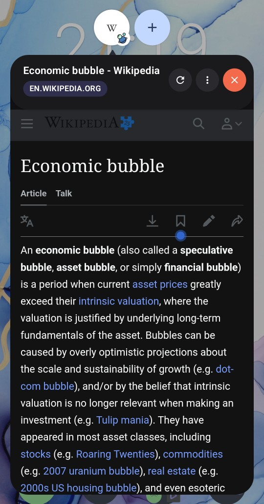
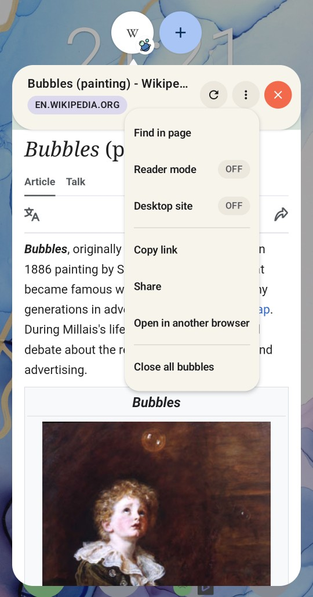
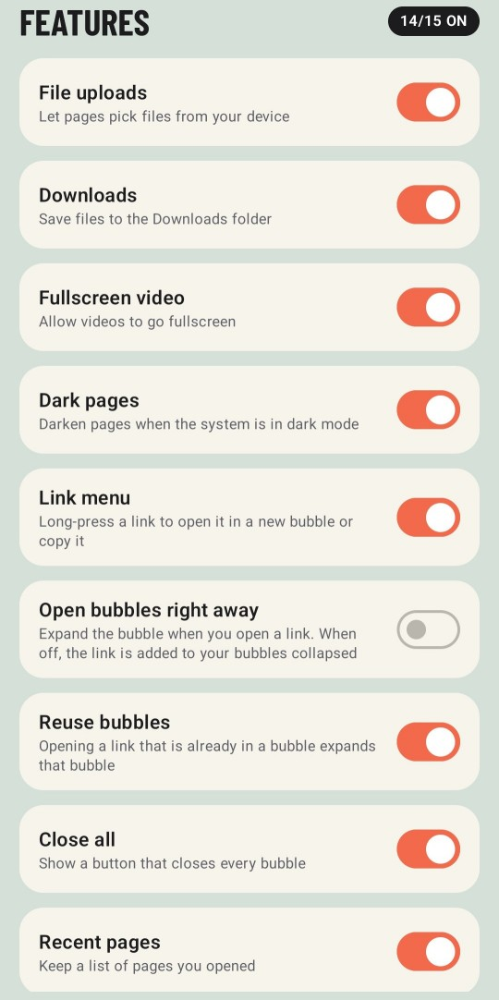
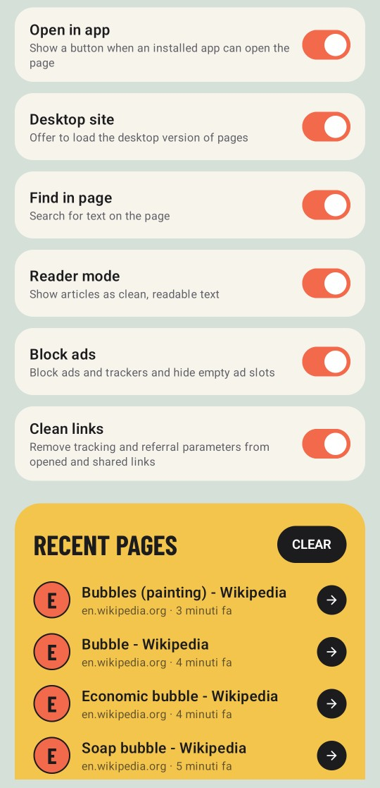

# webble

A webview browser for Android (ab)using the bubbles API. 

I used to have one of these, but it got removed from the Play Store, so I just wasted an afternoon of tokens to make a better one.

> We can rebuild him; we have the technology

## Features

- ad blocking thanks to [Ghostery](https://github.com/ghostery/adblocker)
- reader mode thanks to [Mozilla](https://github.com/mozilla/readability)
- clear trackers from URLs thanks to [ClearURLs](https://gitlab.com/ClearURLs/rules)
- desktop mode
- download and upload files support
- dark mode for websites, following system status

## Install

For now only available on the [release section of GitHub](https://github.com/LivingWithHippos/webble/releases).

To get updates automatically, add it to [Obtainium](https://github.com/ImranR98/Obtainium):

## Screenshots

| Standard                                                                                                              | Dark Mode                                                                                                       | Page Options                                                                                                       |
|-------------------------------------------------------------------------------------------------------------------|--------------------------------------------------------------------------------------------------------------------|------------------------------------------------------------------------------------------------------------|
|  |  |  |

| Settings 1                                                                                                               | Settings 2                                                                                                       |
|-------------------------------------------------------------------------------------------------------------------|--------------------------------------------------------------------------------------------------------------------|
|  |  |

## Donate :coffee:

